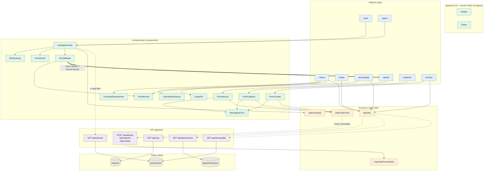
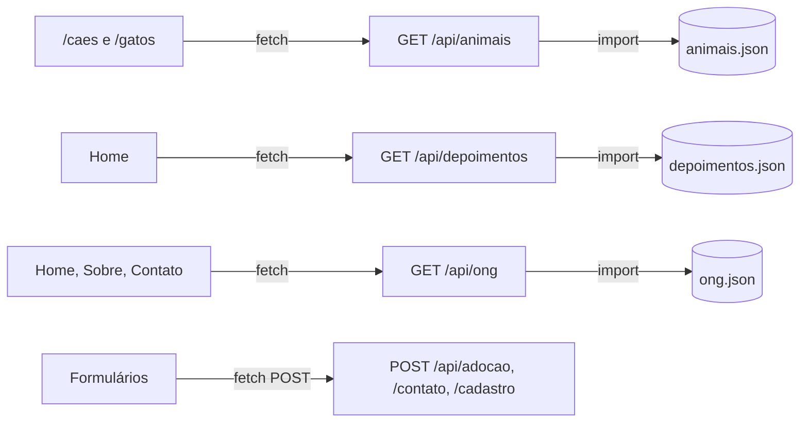

# PetConecta — Especificação Next.js

20/10/2026

## Visão geral

A ideia é transformar o PetConecta num projeto Next.js sem mudar o visual que já temos. Os dados dos animais, depoimentos e da ONG passam a morar num JSON, e as páginas só chegam neles pela API.

Hoje são 7 páginas HTML, um CSS grande e nenhum JavaScript. Os 20 animais estão escritos à mão e o cabeçalho e o rodapé se repetem em todo arquivo. Com o Next a gente escreve cada coisa uma vez só e finalmente coloca as 6 interações planejadas para funcionar.

## Stack e pastas

Next.js 15+ com App Router e TypeScript, o mesmo CSS de hoje (dividido em `globals.css` e CSS Modules), `next/font` para a Plus Jakarta Sans, `next/image` para as fotos e deploy na Vercel.

```text
app/         páginas (page.tsx) e api/ (route.ts)
components/  Header, Footer, AnimalCard...
data/        animais.json, depoimentos.json, ong.json
lib/         types.ts
public/      logo.png, ong.jpeg
```

O detalhe importante: `data/` fica fora de `public/`. Assim o JSON não tem endereço público e a única forma de ler os dados é pela API.

## Rotas

| Antes | Agora | De onde vem o dado |
| --- | --- | --- |
| `ong.html` | `/` | `/api/ong` e `/api/depoimentos` |
| `sobre.html` | `/sobre` | `/api/ong` |
| `caes.html` | `/caes` | `/api/animais?especie=cao` |
| `gatos.html` | `/gatos` | `/api/animais?especie=gato` |
| — | `/animais/[id]` (nova) | `/api/animais/[id]` |
| `cadastro.html` | `/cadastro` | envia para `/api/cadastro` |
| `adotar.html` | `/adotar` | envia para `/api/adocao` |
| `contato.html` | `/contato` | `/api/ong`, envia para `/api/contato` |

Catálogos e formulários rodam no navegador (`"use client"`), porque mudam conforme o usuário mexe. Home e Sobre podem ser renderizadas no servidor.

## Componentes

| Componente | O que substitui |
| --- | --- |
| `Header` e `Footer` | Os blocos copiados nas 7 páginas |
| `AnimalCard` | Os 20 cards escritos à mão |
| `AnimalModal` | Os 20 `<dialog>`, agora um só que recebe o animal clicado |
| `FiltroAnimais` | Os filtros de cães e gatos, que hoje não filtram |
| `CarrosselDepoimentos` | Os 5 depoimentos empilhados |
| `CopiarPix` e `CalculadoraDoacao` | O bloco de doação da Home |
| `FormAdocao`, `FormContato`, `FormCadastro` | Os formulários sem envio |

Na implementação entraram mais três componentes de apoio:

| Componente | Para quê |
| --- | --- |
| `CatalogoAnimais` | Junta filtro, lista de cards e modal nas páginas de Cães e Gatos |
| `FichaAnimal` | Conteúdo da ficha, usado no modal e na página `/animais/[id]` |
| `MensagemForm` | Mensagem de sucesso ou erro dos três formulários |

### Como os componentes se ligam

Linha cheia: renderiza ou importa. Linha tracejada: chamada HTTP (`fetch`). Linha grossa: navegação entre páginas.



Cores: azul são páginas, verde são componentes, laranja são funções e hooks, roxo são rotas da API e cinza são os arquivos JSON.

Três caminhos para seguir no diagrama:

1. **Filtrar animais:** `/caes` renderiza o `CatalogoAnimais`. Cada mudança no `FiltroAnimais` faz o catálogo buscar `GET /api/animais`, que lê o `animais.json`, e cada animal vira um `AnimalCard`.
2. **Do card até a adoção:** "Ver detalhes" abre o `AnimalModal` com a `FichaAnimal`. "Quero Adotar" leva para `/adotar?animal=Nome`, onde o `FormAdocao` já vem preenchido e envia pelo `useEnvioForm` para `POST /api/adocao`.
3. **Home no servidor:** a Home chama `apiGet()` para `/api/ong` e `/api/depoimentos` e passa os dados para o `CarrosselDepoimentos`, o `CopiarPix` e a `CalculadoraDoacao`. Esses três não chamam a API sozinhos.

## API para o JSON

Nossa sugestão é criar a API dentro do próprio Next, com Route Handlers. Não custa nada, sobe junto com o site e deixa claro que a API é nossa, não de um serviço de fora.



As páginas só conhecem URLs `/api/...`; o `import` dos arquivos JSON acontece apenas dentro das rotas da API.

Se preferirem algo pronto, dá para usar o **json-server** (vira uma API REST com um comando, mas precisa rodar à parte) ou o **MockAPI.io** (zero código, mas depende de terceiros).

| Método | Rota | Para quê |
| --- | --- | --- |
| GET | `/api/animais` | Lista, com filtros opcionais na URL (`?especie=gato&sexo=femea`) |
| GET | `/api/animais/[id]` | Um animal só, ou 404 |
| GET | `/api/depoimentos` | Depoimentos da Home |
| GET | `/api/ong` | Números de impacto, Pix, contato, FAQ |
| POST | `/api/adocao`, `/api/contato`, `/api/cadastro` | Valida o formulário e responde 201 ou 400 |

A rota principal fica assim (`app/api/animais/route.ts`):

```ts
import animais from "@/data/animais.json";

export async function GET(req: Request) {
  const especie = new URL(req.url).searchParams.get("especie");
  const lista = especie ? animais.filter(a => a.especie === especie) : animais;
  return Response.json(lista);
}
```

E a página consome com um `fetch` comum:

```ts
const res = await fetch("/api/animais?especie=cao");
const caes = await res.json();
```

### Cuidados

- **Nunca importe o JSON direto numa página.** Funciona, mas quebra a regra "via API". O `import` do JSON só aparece dentro de `app/api/`.
- **Server Component chamando a própria API:** precisa de URL absoluta (`${process.env.NEXT_PUBLIC_SITE_URL}/api/ong`) e `cache: "no-store"`. Sem isso o `next build` tenta buscar a API enquanto o servidor ainda não existe e falha.
- **POST sem banco:** na Vercel o disco é somente leitura, então os formulários validam e devolvem confirmação, mas não guardam nada. Se o professor pedir persistência, troque por json-server local ou um banco grátis (Vercel KV, Supabase).

## Modelo de dados

Cães e gatos usam o mesmo formato. Assim o modal fica igual para os dois, coisa que hoje não acontece.

```json
{
  "id": "mel",
  "nome": "Mel",
  "especie": "cao",
  "sexo": "femea",
  "idade": "1 ano e 7 meses",
  "temperamento": "Dócil e calma",
  "foto": "https://placedog.net/400/300?id=48",
  "saude": "Vacinada, vermifugada e castrada"
}
```

Campos que só servem para uma espécie, como `porte` e `energia` nos cães ou `ambiente` nos gatos, entram só onde fizer sentido. O `ong.json` guarda o resto: impacto, Pix, contato e FAQ.

## Interatividade

As 6 ideias do nosso arquivo de JS viram componentes:

- **Filtro de animais:** cada mudança no filtro busca de novo em `/api/animais`, sem recarregar a página.
- **Calculadora de doação:** enquanto a pessoa digita o valor, aparece quantos dias de ração ou vacinas ele paga.
- **Modal do pet:** um modal só, que mostra o animal clicado e leva para o formulário de adoção.
- **Formulário com resposta na tela:** envia para a API e mostra a confirmação ali mesmo.
- **Carrossel de depoimentos:** setas para passar de um relato para o outro.
- **Copiar Pix:** um clique copia a chave e aparece "Copiado!".

## Tabela de mudanças

| O que era | O que virou | Por quê |
| --- | --- | --- |
| 7 arquivos `.html` soltos | Pastas em `app/` com um `page.tsx` cada | O Next cria as rotas sozinho e as URLs ficam sem `.html` |
| `ong.html` como Home | Rota `/` | A página inicial precisa estar na raiz |
| Cabeçalho e rodapé copiados em cada página | `Header` e `Footer` no layout | Mudou um link? Muda num lugar só |
| Link ativo marcado à mão | Marcado automático pela URL | Não tem como esquecer |
| Logo apontando para `#inicio` | Logo leva para `/` | Hoje, fora da Home, clicar no logo não faz nada |
| Menu mobile com truque de checkbox | Menu com estado do React | Fecha sozinho ao trocar de página e é mais acessível |
| `<a href="caes.html">` | `<Link href="/caes">` | Troca de página sem recarregar tudo |
| 20 animais escritos no HTML | `animais.json` lido pela API | É a exigência do projeto, e um animal novo vira só uma linha no JSON |
| 20 cards e 20 modais repetidos | Um `AnimalCard` e um `AnimalModal` | Menos código e nada de copiar e colar |
| Modal de cão diferente do de gato | Mesmo formato para os dois | A ficha fica padronizada |
| Filtros que só recarregam a página | Filtros que buscam na API na hora | Agora filtram de verdade |
| Coração de favoritar sem ação | Favoritos salvos no navegador | Botão que não funciona confunde |
| "Quero Adotar" sem ação | Abre o formulário já com o nome do animal | Liga o catálogo à adoção |
| Botão do Pix sem ação | Copia a chave com um clique | Facilita a doação |
| Depoimentos empilhados | Carrossel com setas | Ocupa menos espaço na Home |
| Formulários sem envio | Envio pela API com resposta na tela | A pessoa sabe que deu certo |
| Cadastro com as 3 etapas abertas | Uma etapa por vez, com Avançar e Voltar | As abas "1, 2, 3" passam a funcionar |
| Vários `<h1>` por página | Um `<h1>` por página | Acessibilidade e SEO, sem mudar o visual |
| Um `style.css` gigante | `globals.css` + CSS por componente | Cada estilo fica junto do seu componente |
| Fonte e imagens carregadas à moda antiga | `next/font` e `next/image` | Site mais leve e rápido |
| Mesmo título de aba em todas as páginas | Título próprio por página | Dá para saber em que aba se está |

## Plano

1. Criar o projeto com `npx create-next-app@latest` e copiar logo, foto e CSS.
2. Montar o layout com `Header` e `Footer`.
3. Passar os animais, depoimentos e dados da ONG para os JSON.
4. Escrever as rotas GET da API e testar no navegador.
5. Montar Cães e Gatos, depois Home e Sobre.
6. Fazer os formulários com as rotas POST e subir na Vercel.
